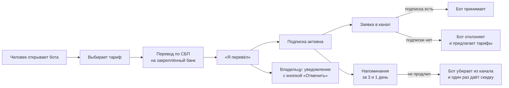

# Бот подписки на закрытый Telegram-канал

Бот продаёт доступ к закрытому каналу с учебными материалами для студентов экономфака МГУ.
Берёт оплату, пускает в канал только тех, у кого есть подписка, напоминает о продлении и сам
убирает тех, кто не продлил. Владелец канала ведёт всё прямо из чата с ботом: подписчиков,
промокоды, рассылки, статистику.

Сделан под заказ и работает с реальными подписчиками.

**Стек:** Python 3.11+, aiogram 3 (Bot API 10.x), SQLite (aiosqlite), openpyxl, systemd.

## Что умеет

**Для подписчика**
- Три тарифа: месяц, 3 месяца и год. Год показан как выгодное предложение: первым в списке,
  с ценой за месяц и процентом экономии. Продление заранее прибавляет дни к текущему сроку.
- Перед первой оплатой бот спрашивает ФИО и группу, чтобы владелец понимал, чей перевод.
- Оплата переводом по СБП: бот показывает номер и банк, доступ включается после «Я перевёл».
- Вход в канал по заявке. Ссылку не страшно слить: бот принимает заявку, только если подписка
  оплачена.
- Напоминания за 3 дня и за 1 день до конца подписки.
- Реферальная программа: +30 дней за каждого оплатившего друга, каждый 5-й друг даёт доступ
  до конца курса.
- Подписка в подарок, промокоды, частые вопросы, связь с админом.

**Для владельца**
- Уведомление о каждой оплате с кнопкой «Отменить», если денег на счёте нет.
- Чередование банков: каждому новому подписчику закрепляется свой банк (Т-Банк / Сбер), чтобы
  переводы делились поровну.
- `/stats`: подписки, выручка за месяц по банкам, отток, источники трафика.
- `/export`: выгрузка подписчиков (с ФИО и группой) и платежей в Excel с фильтрами.
- Промокоды и ссылки с метками источника, чтобы видеть, какая реклама приносит деньги.
- Рассылки по сегментам: всем, активным, бывшим подписчикам, тем, кто не покупал.
- Ручная выдача и отзыв доступа, подарочные коды для розыгрышей.
- Подключение канала без правки конфига: переслать боту пост из канала.

## Как это работает



Фоновый планировщик раз в 2 минуты проверяет сроки подписок: шлёт напоминания, отключает
истёкших и сжигает неоплаченные заявки.

## Интересные решения

- **Одна ссылка на всех вместо одноразовых.** Ссылка создаёт заявку на вступление, и бот решает
  по каждой заявке сам. Поэтому её можно выложить где угодно: без подписки в канал не попасть.
  Сообщение человеку отправляется до обработки заявки, пока Telegram разрешает написать тому,
  кто ни разу не запускал бота.
- **Одна точка оплаты.** Любой способ оплаты сводится к `services.on_paid()`, а промокоды,
  рефералка, подарки и статистика уже завязаны на неё. Чтобы подключить ЮKassa или звёзды,
  достаточно вызвать её из нового обработчика.
- **Защита от злоупотреблений.** Реферальный бонус начисляется только после оплаты друга, так что
  второй аккаунт ничего не даст. Скидка «вернись» выдаётся один раз на человека, чтобы
  подписчики не привыкли ждать её каждый месяц.
- **Два режима выдачи материалов.** Если канал подключён, бот работает как привратник. Если нет,
  бот сам выдаёт предметы одним rich-сообщением (Bot API 10.1): темы сворачиваются, файлы
  защищены от пересылки.

## Структура

```
main.py          запуск, регистрация роутеров, проверка прав в канале
config.py        настройки из .env, тарифы, тексты
db.py            схема SQLite и хелперы
services.py      подписки, канал, оплаты, рефералка, подарки
manual_pay.py    оплата переводом по СБП, чередование банков
scheduler.py     напоминания и отключение по сроку
materials.py     выдача материалов rich-сообщениями (режим без канала)
handlers/user.py  меню подписчика, оплата, заявки в канал
handlers/admin.py админка: канал, подписчики, статистика, Excel, промокоды, рассылки
install.sh       установка на Ubuntu: venv, systemd, ежедневный бэкап базы
```

## Запуск

```bash
git clone https://github.com/whitleyguynova/msu-subscription-bot.git
cd msu-subscription-bot
cp .env.example .env      # вписать BOT_TOKEN, ADMIN_IDS, реквизиты для переводов
pip install -r requirements.txt
python main.py
```

На сервере (Ubuntu 22.04/24.04, за пределами РФ, чтобы Telegram API был доступен):

```bash
sudo bash install.sh
```

Скрипт ставит зависимости, настраивает автозапуск через systemd и ежедневную копию базы.
Подробная инструкция для владельца — в [docs/SETUP.md](docs/SETUP.md).

## Команды админа

| Команда | Что делает |
| --- | --- |
| `/channel` | Проверить подключение канала и права бота |
| `/paid @ник m1` | Занести оплату вручную |
| `/grant @ник 30` · `/revoke @ник` | Выдать или забрать доступ |
| `/info @ник` | Карточка подписчика |
| `/stats` · `/export` | Статистика и выгрузка в Excel |
| `/addpromo КОД 20` · `/promos` | Промокоды и их эффективность |
| `/gift m1 5` | Подарочные ссылки |
| `/broadcast former` | Рассылка по сегменту |
| `/courseend 30.06.2027` | Дата конца курса для реферального приза |
| `/avatar` | Сменить аватарку бота |

Полный список — `/admin` в боте.
